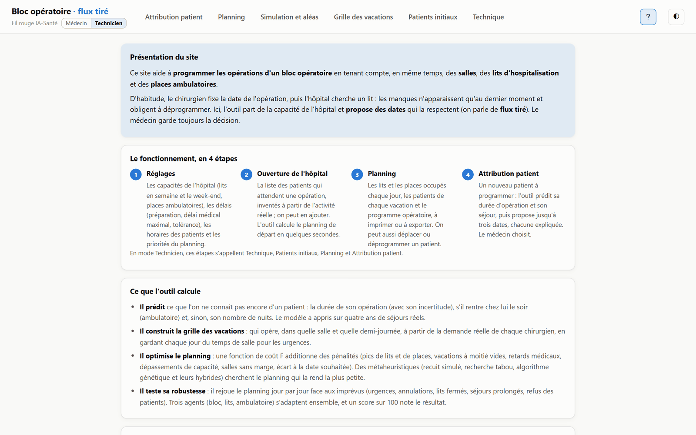
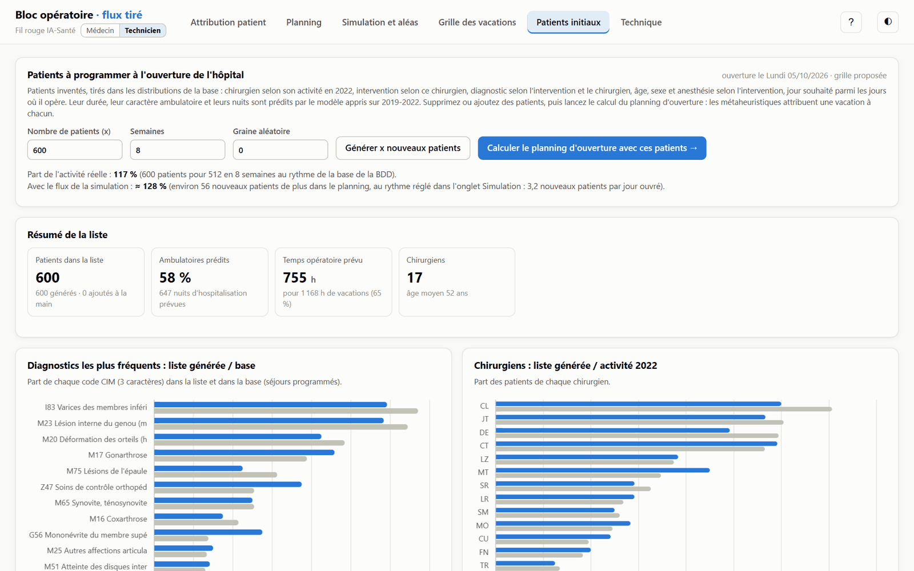
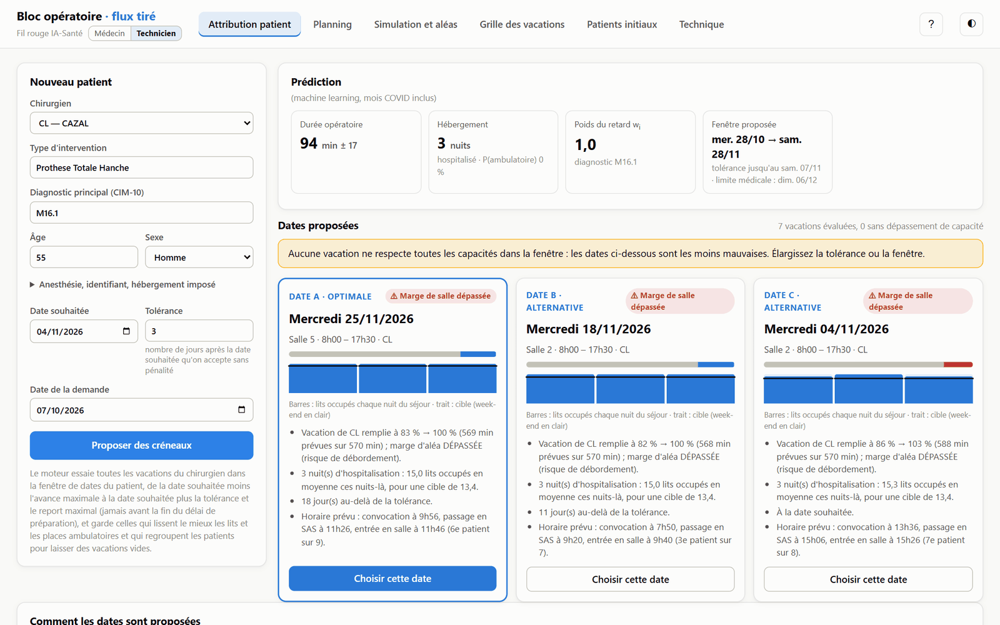
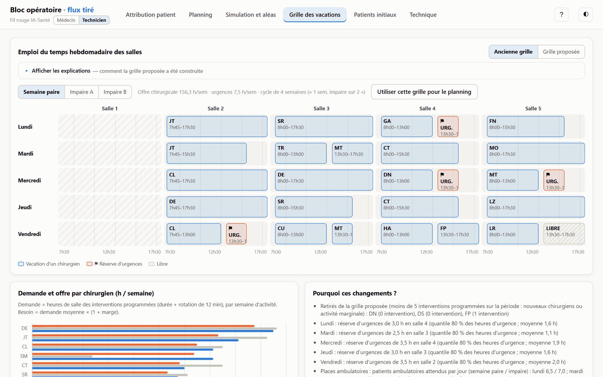

<div align="center">

# 🏥 Bloc opératoire · flux tiré

**Programmer les opérations d'un bloc opératoire en tenant compte, en même temps, des salles, des lits d'hospitalisation et des places ambulatoires.**

Projet fil rouge IA-Santé : prédiction par apprentissage automatique, métaheuristiques et système multi-agents


</div>

> 🎓 **Contexte :** projet réalisé dans le cadre de l'**électif d'intégration IA et Santé** de l'**École Centrale de Lille**,
> sous la supervision de **M. Slim HAMMADI**. Il répond au **besoin réel d'un client médecin**.
>
> 👥 **Équipe :** David LANSADE, Robin CURSENTE, Clément MORIN, Rafael LAZAR.

---

## Sommaire

- [Le problème](#le-problème)
- [Ce que fait le logiciel](#ce-que-fait-le-logiciel)
- [Captures d'écran](#captures-décran)
- [Installation et lancement](#installation-et-lancement)
- [Utilisation pas à pas](#utilisation-pas-à-pas)
- [Comment ça marche](#comment-ça-marche)
- [Structure du dépôt](#structure-du-dépôt)
- [Pour les développeurs](#pour-les-développeurs)
- [Données](#données)
- [Auteurs](#auteurs)

---

## Le problème

Aujourd'hui, la programmation du bloc fonctionne en **flux poussé** : le chirurgien fixe une date d'opération, puis
l'hôpital cherche un lit. Les manques n'apparaissent qu'au dernier moment, ce qui oblige à déprogrammer, et le
remplissage des lits alterne entre des **pics** et des **creux**.

Ce projet inverse la logique (**flux tiré**) : l'outil part de la capacité de l'hôpital (salles, lits, places
ambulatoires, personnel) et **propose au chirurgien les meilleures dates**. Le médecin garde toujours la décision.

> Les consignes initiales du projet sont dans [`docs/Optimisation_bloc_operatoire_IA.pptx`](docs/Optimisation_bloc_operatoire_IA.pptx).

## Ce que fait le logiciel

| | Fonction | En bref |
|---|---|---|
| 🔮 | **Prédire** | Durée opératoire (avec son incertitude), probabilité d'ambulatoire et nombre de nuits, appris sur 4 ans de séjours réels (2019-2022). |
| 🗓️ | **Construire la grille des vacations** | Qui opère, dans quelle salle et sur quelle demi-journée, d'après la demande réelle de chaque chirurgien, avec une réserve quotidienne pour les urgences. |
| ⚙️ | **Optimiser le planning d'ouverture** | Plusieurs centaines de patients à placer d'un coup : recuit simulé, recherche tabou, algorithme génétique et 5 hybrides minimisent une fonction de coût F. |
| 👩‍⚕️ | **Proposer des dates à un nouveau patient** | Jusqu'à trois dates (A optimale, B et C alternatives), chacune expliquée (lits, remplissage de la salle, écart à la date souhaitée, horaire de convocation). |
| 🎲 | **Tester la robustesse** | Le planning est rejoué jour après jour face aux imprévus (urgences, annulations, lits fermés, séjours prolongés, refus des patients). Trois agents (Bloc, Lits, Ambulatoire) se coordonnent, et un score de robustesse sur 100 note le résultat. |
| 🖨️ | **Exporter** | Programme opératoire à imprimer (PDF) ou à ouvrir dans Excel. |

L'interface a deux modes :

- **Médecin** : 4 onglets dans l'ordre du travail (Réglages, Ouverture de l'hôpital, Planning, Attribution patient) ;
- **Technicien** : tout le site (simulation, grille, comparaison des méthodes, réglages fins de F).

## Captures d'écran

<table>
<tr>
<td width="50%"><b>Présentation du site</b><br></td>
<td width="50%"><b>Patients initiaux</b> : patients inventés à partir de l'activité réelle, comparés à la base<br></td>
</tr>
<tr>
<td><b>Attribution patient</b> : prédiction et dates A / B / C expliquées<br></td>
<td><b>Planning</b> : lits par nuit, places ambulatoires par jour, remplissage des salles<br></td>
</tr>
<tr>
<td><b>Grille des vacations</b> : ancienne grille et grille proposée<br></td>
<td><b>Simulation et aléas</b> : système multi-agents face aux imprévus<br></td>
</tr>
<tr>
<td colspan="2"><b>Technique</b> : poids de la fonction objectif, capacités, délais, comparaison des métaheuristiques<br></td>
</tr>
</table>

## Installation et lancement

**Prérequis :** Python 3.11 ou plus récent (développé avec Python 3.14). Une connexion Internet est utile pour
afficher les graphiques et les formules : Chart.js et KaTeX sont chargés depuis un CDN.

```bash
git clone https://github.com/david-lansade/ordonnancement-blocs-operatoires-centrale.git
cd ordonnancement-blocs-operatoires-centrale
python -m venv .venv
```

Installer les dépendances puis lancer :

**Windows**

```bash
.venv\Scripts\python -m pip install -r requirements.txt
.venv\Scripts\python lancer.py
```

**Linux / macOS**

```bash
.venv/bin/python -m pip install -r requirements.txt
.venv/bin/python lancer.py
```

Ouvrir ensuite **http://127.0.0.1:5000** dans un navigateur.

> Au premier lancement, la base est nettoyée et les modèles de prédiction sont entraînés (environ 30 s). Le
> résultat est mis en cache dans `data/processed/`, que l'application recrée seule si on le supprime.

## Utilisation pas à pas

1. **Réglages** : capacités de l'hôpital (lits en semaine et le week-end, places ambulatoires), délais, priorités.
2. **Ouverture de l'hôpital** (*Patients initiaux* en mode Technicien) : générer *x* patients (600 sur 8 semaines par
   défaut), en ajouter ou en retirer, puis lancer le calcul du planning d'ouverture.
3. **Planning** : vérifier les lits et les places occupés, les vacations semaine par semaine, déplacer ou
   déprogrammer un patient, imprimer le programme opératoire.
4. **Attribution patient** : saisir un nouveau patient (chirurgien, intervention, diagnostic CIM-10, âge, sexe, date
   souhaitée) et choisir l'une des dates proposées.

Le bouton **?** de l'en-tête ouvre une présentation complète du site.

## Comment ça marche

### Les deux phases

1. **Planning vierge (nouvel hôpital).** Plusieurs centaines de demandes arrivent en même temps. Les patients sont
   **inventés** de façon cohérente avec la base (`src/generation.py`) puis ordonnancés par les trois métaheuristiques
   et leurs hybrides, comparés sur la même instance, avec les mêmes graines et le même budget d'évaluations. La
   meilleure solution est « adoptée » comme planning initial.
2. **Patients un par un.** Le modèle prédit durée, ambulatoire et nuits ; le moteur essaie toutes les vacations
   admissibles en gardant les autres patients fixés (insertion gloutonne) et propose jusqu'à trois dates sur des
   jours différents.

### La fonction objectif F

F additionne des pénalités pondérées :

| Poids | Terme |
|---|---|
| W1, W1′ | lissage des lits occupés et des places ambulatoires autour d'une cible proportionnelle au personnel |
| W2 | regroupement des patients pour libérer des vacations entières |
| W3 | retard au-delà de la limite médicale, pondéré par l'urgence du diagnostic w_i |
| W4 | dépassement des capacités (lits, places) |
| W5 | marge d'aléa des salles : Σµ + z_β·√Σσ² ne doit pas dépasser la durée de la vacation |
| W6 | écart à la date souhaitée par le patient (au-delà de la tolérance τ_i) |

Les poids par défaut viennent d'une **optimisation bayésienne sous contraintes** (`scripts/optimisation_poids.py`).

### Les méthodes d'optimisation

- **Recuit simulé**, **recherche tabou**, **algorithme génétique** (`src/metaheuristiques/`)
- **Hybrides** : relais Recuit → Tabou, Génétique → Recuit, Génétique → Tabou, algorithme mémétique, recuit à liste tabou
- Évaluation de F **vectorisée** (numpy) et **incrémentale** pour aller vite, avec des tests qui vérifient l'égalité
  exacte avec l'implémentation de référence.

### Simulation multi-agents (Mesa)

Trois agents, **Bloc**, **Lits** et **Ambulatoire**, réagissent aux aléas tirés avec une graine (urgences réelles
de la base, annulations, lits fermés, durées N(µ, σ), séjours prolongés, refus des patients, nouveaux patients en
flux). Trois stratégies sont comparées sur les mêmes aléas : sans coordination, avec les agents, et réoptimisation
centralisée. Un **score de robustesse R sur 100** (12 critères) note chaque planning.

## Structure du dépôt

```
├── lancer.py                 point d'entrée : lance le serveur web
├── requirements.txt
├── app/                      serveur Flask + interface (HTML / CSS / JS)
│   └── static/resultats/     résultats pré-calculés (balayage et optimisation des poids)
├── src/
│   ├── chargement.py         lecture et nettoyage de la base des séjours
│   ├── urgences.py           tri urgences / programmé, réserve au quantile 80 %
│   ├── prediction.py         étude statistique + gradient boosting (µ, σ, ambulatoire, nuits)
│   ├── generation.py         patients inventés pour l'ouverture
│   ├── grille.py             grille actuelle, nouvelle grille, calendrier des vacations
│   ├── modele.py             construction de l'instance d et fonction objectif evaluer
│   ├── scenario.py           paramètres, poids par diagnostic, instance initiale
│   ├── metaheuristiques/     recuit, tabou, génétique, hybrides
│   ├── comparaison.py        comparaison équitable des méthodes (exécution parallèle)
│   ├── planning.py           planning en ligne : propositions A / B / C, déplacements
│   ├── horaires.py           programme horaire d'une vacation (ordre de passage, convocations)
│   ├── aleas.py, sma.py      aléas et système multi-agents
│   ├── robustesse.py         score de robustesse R
│   ├── campagne.py           scénarios (charge normale, surcharge, perturbations…)
│   └── export.py             programme opératoire en Excel
├── scripts/                  comparaison des métaheuristiques, balayage et optimisation des poids
├── tests/                    tests pytest
├── data/                     les deux classeurs Excel fournis (voir « Données »)
└── docs/
    ├── Optimisation_bloc_operatoire_IA.pptx   consignes initiales du projet
    └── captures/                              captures d'écran du README
```

## Pour les développeurs

### Tests

```bash
.venv\Scripts\python -m pytest tests        # Windows
.venv/bin/python -m pytest tests            # Linux / macOS
```

| Fichier | Ce qui est vérifié |
|---|---|
| `test_modele.py` | `evaluer` est la référence ; les versions incrémentale et vectorisée donnent exactement la même valeur |
| `test_hybrides.py` | hybrides : budget, admissibilité, F exact ; exécution parallèle identique à la séquentielle |
| `test_aleas_sma.py` | aléas reproductibles ; sans aléa le SMA suit le planning ; réparation admissible et exacte |
| `test_refus.py` | refus des nouvelles dates par les patients |
| `test_robustesse.py` | score de robustesse R |

### Scripts

| Script | Rôle |
|---|---|
| `scripts/comparer_metaheuristiques.py` | figures et CSV de comparaison des méthodes (dossier `figures/`) |
| `scripts/balayage_poids.py` | balayage des poids W_k de F (×0,2 à ×5) sur des plannings simulés |
| `scripts/optimisation_poids.py` | optimisation bayésienne sous contraintes des poids par défaut de F |

### Format de `d` et `evaluer`

La signature `evaluer(solution, d)` est stable. **Sans les clés facultatives ci-dessous, le résultat est exactement
celui de la version de référence** (vérifié par `tests/test_modele.py`).

| Clé facultative | Contenu | Défaut |
|---|---|---|
| `poids` | dict `{"W1", "W1b", "W2", "W3", "W4", "W5", "W6"}` qui remplace les poids par défaut | constantes de `modele.py` ; l'application passe `scenario.PARAMETRES_DEFAUT` (W1 1, W1′ 2,5, W2 0,012, W3 30, W4 100, W5 0,19, W6 0,014) |
| `souhait[i]` | jour souhaité s_i : ajoute W6 Σ [max(0, s_i − j_i) + max(0, j_i − s_i − τ_i)] | absent |
| `tolerance[i]` | τ_i, jours acceptés après s_i sans pénalité | 0 |
| `poids_retard[i]` | w_i du diagnostic : terme W3 Σ w_i max(0, j_i − d_i) | 1 |
| `lits_reserves[t]`, `places_reservees[t]` | lits et places pris par les urgences | 0 |
| `z_beta` | coefficient de la marge d'aléa des salles | 1,0 |
| `penaliser_capacites` | ajoute les termes W4 (capacités) et W5 (marge des salles) | False |

Deux évaluateurs plus rapides donnent la même valeur : `EvaluateurVect(d)(solution)` (numpy) et
`Evaluateur(d, solution)` (incrémental : `essayer(i, v)`, `deplacer(i, v)`, `essayer_echange(i, k)`).

### Choix de modélisation

- **Capacités** : pénalités W4 et W5 plutôt que le rejet des voisins infaisables.
- **Nuits** L_i = sortie − entrée, comptées à partir du jour opératoire.
- **Urgences hors de F** : F ne porte que sur les patients programmés ; les urgences gardent leur réserve de salle
  dans la grille et leur profil moyen sert de prévision aux agents de la simulation.
- **Délais** : d_i = date de la demande + délai médical maximal (60 j par défaut) ; fenêtre dure des dates
  proposables = [s_i − 7 j, s_i + τ_i + 21 j].
- **µ_i** = durée prédite + rotation entre deux patients (5 min par défaut ; à 0, la rotation mesurée de 12 min
  s'ajoute entre deux patients).
- **Nouvelle grille** : besoin = demande moyenne × (1 + 10 %) ; chirurgiens retenus s'ils ont au moins 5 interventions
  programmées ; réserve d'urgences placée d'abord (quantile 80 % par jour), puis placement glouton (journées
  entières privilégiées, jours de consultation respectés, longs séjours évités en fin de semaine, équilibre entre
  semaines paires et impaires).

## Données

Le dossier `data/` contient les deux classeurs fournis pour le projet :

- `donees bloc anonyme pour centrale 2026.xlsx` : environ 14 650 séjours chirurgicaux de 2019 à 2022 (dates,
  diagnostics CIM-10, actes CCAM, horaires de bloc, type d'anesthésie, durée de séjour) ;
- `Vacations Opératoires anonymiséees.xlsx` : la grille hebdomadaire des vacations des 5 salles.

Ces données servent uniquement à un usage pédagogique, dans le cadre du projet.

## Auteurs

Projet de l'électif d'intégration IA et Santé, École Centrale de Lille, supervisé par M. Slim HAMMADI (groupe 5) :
**David LANSADE**, **Robin CURSENTE**, **Clément MORIN**, **Rafael LAZAR**.
