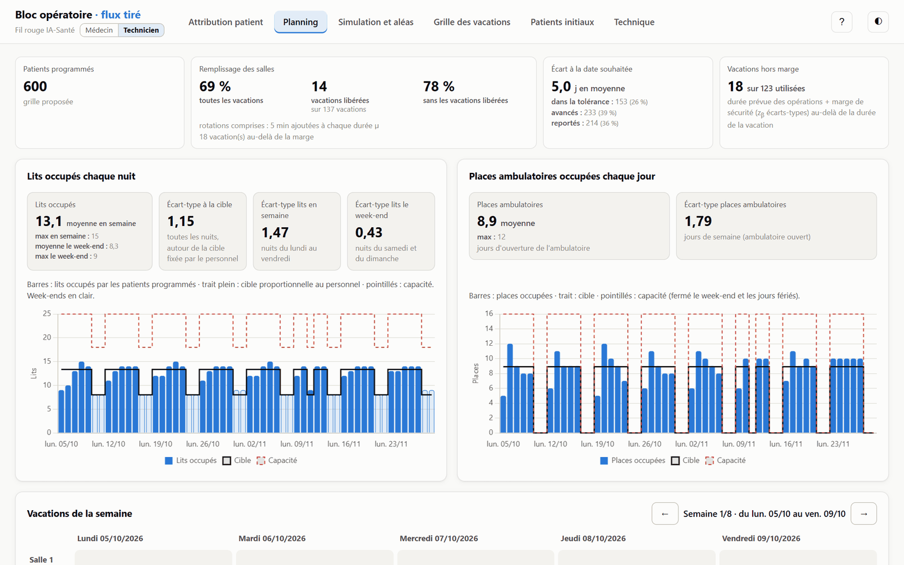
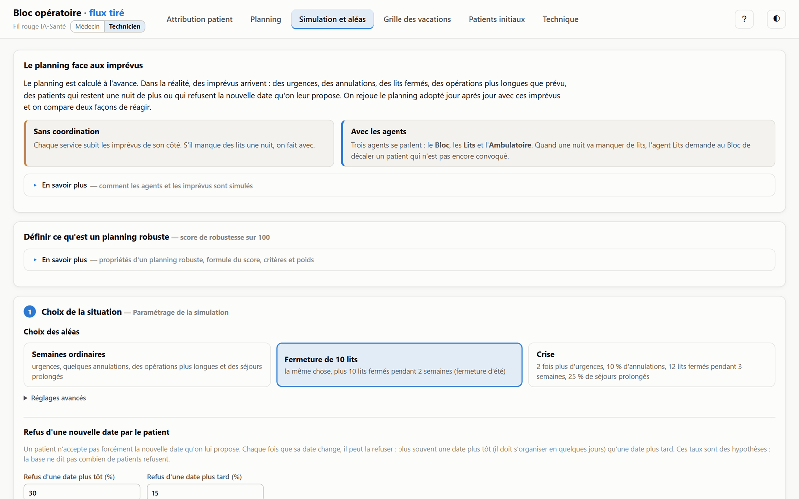
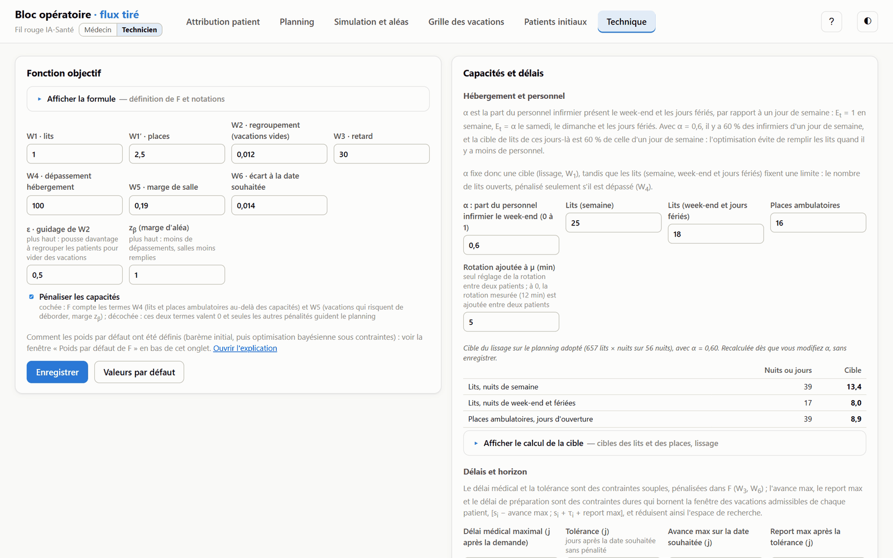
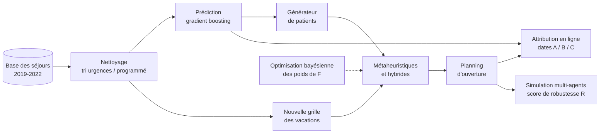

<div align="center">

# 🏥 Bloc opératoire · flux tiré

**Programmer les opérations d'un bloc opératoire en tenant compte, en même temps, des salles, des lits d'hospitalisation et des places ambulatoires.**

Outil d'aide à la décision : prédiction par apprentissage automatique, métaheuristiques hybrides et système multi-agents




</div>

> 🎓 **Contexte :** projet réalisé dans le cadre de l'**électif d'intégration IA et Santé** de l'**École Centrale de Lille**,
> sous la supervision de **M. Slim HAMMADI**. Il répond au **besoin réel d'un client médecin**.
>
> 👥 **Équipe :** David LANSADE, Robin CURSENTE, Clément MORIN, Rafael LAZAR.

<div align="center">

| 📊 **14 649** | ⚙️ **8** | ⏱️ **≈ 16 s** | 🛡️ **+10 points** |
|:---:|:---:|:---:|:---:|
| séjours chirurgicaux réels (2019-2022) pour apprendre | méthodes d'optimisation comparées à budget égal | pour programmer 600 patients sur 8 semaines (meilleur hybride) | de robustesse en situation de crise grâce aux agents |

</div>

---

## Sommaire

- [Le besoin](#le-besoin)
- [Pourquoi c'est difficile](#pourquoi-cest-difficile)
- [Ce que fait le logiciel](#ce-que-fait-le-logiciel)
- [Captures d'écran](#captures-décran)
- [Résultats](#résultats)
- [Architecture](#architecture)
- [Installation et lancement](#installation-et-lancement)
- [Utilisation pas à pas](#utilisation-pas-à-pas)
- [Comment ça marche](#comment-ça-marche)
- [Technologies](#technologies)
- [Structure du dépôt](#structure-du-dépôt)
- [Pour les développeurs](#pour-les-développeurs)
- [Limites et pistes](#limites-et-pistes)
- [Données](#données)
- [Auteurs](#auteurs)

---

## Le besoin

Le bloc opératoire est l'un des plateaux techniques les plus coûteux d'un hôpital, et il commande l'activité des
services qui reçoivent les patients après l'intervention : les **lits d'hospitalisation** et les **places de
chirurgie ambulatoire**.

Aujourd'hui, la programmation fonctionne en **flux poussé** : le chirurgien fixe une date avec son patient, puis le
service cherche un lit. Les manques n'apparaissent qu'au dernier moment, ce qui oblige à déprogrammer, et le
remplissage des lits devient erratique : pour une même capacité, de 15 à 42 lits chirurgicaux sont occupés d'une
période à l'autre. Le problème tient autant au **moment** des admissions qu'à leur **volume**.

Le médecin à l'origine du projet attendait un outil qui :

- **propose des dates** à chaque patient en tenant compte des lits et des salles disponibles ;
- **anticipe** l'occupation à venir au lieu de subir les pics ;
- **lisse** l'occupation des lits, ce qui réduit le nombre de lits nécessaires et apaise les équipes ;
- **réduit l'attente** des patients ;
- laisse **toujours la décision au médecin**, avec des propositions qu'il peut comprendre.

Ce projet répond à ce besoin par un **flux tiré** : l'outil part de la capacité de l'hôpital et répond au chirurgien
« voici les trois meilleures dates, et pourquoi » plutôt que « quelle date voulez-vous ? ».

> Les consignes initiales du projet sont dans [`docs/Optimisation_bloc_operatoire_IA.pptx`](docs/Optimisation_bloc_operatoire_IA.pptx).

## Pourquoi c'est difficile

- **Combinatoire.** Ouvrir un hôpital revient à placer environ 600 patients dans 137 vacations (les créneaux de salle
  de chaque chirurgien) sur 8 semaines, soit environ 2 870 variables binaires (patient, vacation possible).
- **Objectif non linéaire.** La fonction de coût contient des carrés, des parties positives et une racine, et les
  cibles d'occupation dépendent elles-mêmes de la solution. Une résolution exacte par programmation linéaire en
  nombres entiers est donc peu adaptée, d'où le choix des **métaheuristiques**.
- **Incertitude.** Les durées d'intervention et de séjour ne sont pas connues à l'avance, et les urgences, les
  annulations ou les fermetures de lits perturbent le planning.
- **Objectifs contradictoires.** Lisser les lits, remplir les salles sans les faire déborder, respecter les délais
  médicaux et les souhaits des patients ne vont pas dans le même sens.
- **Explicabilité.** Un médecin n'adoptera pas une date sortie d'une boîte noire : chaque proposition doit être
  justifiée.

## Ce que fait le logiciel

| | Fonction | En bref |
|---|---|---|
| 🔮 | **Prédire** | Durée opératoire (avec son incertitude), probabilité d'ambulatoire et nombre de nuits, appris sur 4 ans de séjours réels (2019-2022). |
| 🗓️ | **Construire la grille des vacations** | Qui opère, dans quelle salle et sur quelle demi-journée, d'après la demande réelle de chaque chirurgien, avec une réserve quotidienne pour les urgences. |
| ⚙️ | **Optimiser le planning d'ouverture** | Plusieurs centaines de patients à placer d'un coup : recuit simulé, recherche tabou, algorithme génétique et 5 hybrides minimisent une fonction de coût F. |
| 👩‍⚕️ | **Proposer des dates à un nouveau patient** | Jusqu'à trois dates (A optimale, B et C alternatives), chacune expliquée (lits, remplissage de la salle, écart à la date souhaitée, horaire de convocation). |
| 🎲 | **Tester la robustesse** | Le planning est rejoué jour après jour face aux imprévus (urgences, annulations, lits fermés, séjours prolongés, refus des patients). Trois agents (Bloc, Lits, Ambulatoire) se coordonnent, et un score de robustesse sur 100 note le résultat. |
| 🖨️ | **Exporter** | Programme opératoire à imprimer (PDF) ou à ouvrir dans Excel. |

L'interface a deux modes :

- **Médecin** : 4 onglets dans l'ordre du travail (Réglages, Ouverture de l'hôpital, Planning, Attribution patient) ;
- **Technicien** : tout le site (simulation, grille, comparaison des méthodes, réglages fins de F).

## Captures d'écran

<table>
<tr>
<td width="50%"><b>Attribution patient</b> : prédiction et dates A / B / C expliquées<br></td>
<td width="50%"><b>Planning</b> : lits par nuit, places ambulatoires par jour, remplissage des salles<br></td>
</tr>
<tr>
<td><b>Grille des vacations</b> : ancienne grille et grille proposée<br></td>
<td><b>Simulation et aléas</b> : système multi-agents face aux imprévus<br></td>
</tr>
<tr>
<td><b>Patients initiaux</b> : patients inventés à partir de l'activité réelle, comparés à la base<br></td>
<td><b>Technique</b> : poids de la fonction objectif, capacités, délais<br></td>
</tr>
<tr>
<td colspan="2" align="center"><b>Présentation du site</b><br></td>
</tr>
</table>

## Résultats

**Protocole.** Ouverture d'un hôpital fictif : 600 patients générés sur 8 semaines (598 programmables, 2 n'ayant
aucune vacation possible dans l'horizon), 137 vacations, 48 204 minutes d'interventions demandées pour 70 050 minutes
offertes. Chaque méthode reçoit la même solution de départ, les mêmes graines (5) et le même budget de
**200 000 évaluations de F**. Machine : AMD Ryzen AI 7 350, 32 Go de RAM.

### Prédiction : apprendre sur 2019-2021, tester sur 2022

| Méthode | Erreur moyenne sur la durée | Erreur moyenne sur les nuits | Ambulatoire bien classé |
|---|---:|---:|---:|
| Moyenne globale (référence naïve) | 29,8 min | 1,18 nuit | 54,0 % |
| Étude statistique (cas similaires) | 16,7 min | 0,44 nuit | 88,4 % |
| **Gradient boosting** | **14,5 min** | **0,35 nuit** | **91,9 %** |

Test sur 3 669 séjours de 2022. Exclure les mois de COVID-19 n'améliore pas les modèles : ils sont gardés.

### Optimisation : 8 méthodes comparées à budget égal

| Méthode | Famille | F moyen (écart-type) | Écart-type des lits | Vacations hors marge | Temps |
|---|---|---:|---:|---:|---:|
| **Génétique → Recuit** | hybride en relais | **11 934** (34) | **1,13** | 18 | 16 s |
| Recuit → Tabou | hybride en relais | 11 950 (41) | 1,39 | 17 | 11 s |
| Recuit simulé | seule | 11 982 (50) | 1,40 | 15 | 11 s |
| Génétique → Tabou | hybride en relais | 12 009 (40) | 1,38 | 15 | 15 s |
| Recuit à liste tabou | hybride intégré | 12 013 (18) | 1,30 | 18 | 11 s |
| Algorithme mémétique | hybride intégré | 12 033 (17) | 1,36 | 17 | 11 s |
| Recherche tabou | seule | 12 061 (111) | 1,29 | 17 | 9 s |
| Algorithme génétique | seule | 13 286 (384) | 1,77 | 19 | 64 s |
| *Insertion gloutonne* | *référence* | *33 441* | *2,18* | *33* | |
| *Solution aléatoire* | *référence* | *438 027* | *5,16* | *38* | |

- Le meilleur hybride (Génétique → Recuit) fait **2,8 fois mieux que l'insertion gloutonne**, en respectant toutes les
  capacités de lits et de places.
- Hors algorithme génétique seul, les méthodes se tiennent à environ 1 % près : **l'optimisation globale compte beaucoup plus
  que le choix fin de la métaheuristique**.

### Robustesse : le planning face aux imprévus

Le meilleur planning est rejoué jour après jour avec trois stratégies, sur **20 tirages appariés** (mêmes aléas et
mêmes nouveaux patients pour les trois stratégies).

| Situation | Score R sans coordination | Score R avec les agents | Score R réoptimisation centralisée | Lits manquants (sans coord. → agents) |
|---|---:|---:|---:|---:|
| Aléas ordinaires | 87,2 | **87,9** | 87,2 | 0 → 0 |
| Ordinaires + nouveaux patients | 84,2 | **85,0** | 84,4 | 0 → 0 |
| 10 lits fermés + nouveaux patients | 75,0 | **80,0** | 79,6 | 18,2 → 7,9 (**−57 %**) |
| Crise + nouveaux patients | 50,7 | **60,7** | 59,5 | 66,5 → 36,1 (**−46 %**) |

La coordination entre le bloc et les services d'hospitalisation ne paie vraiment que **quand les lits manquent** :
+0,7 point en régime ordinaire, **+10 points en crise**. La réoptimisation centralisée s'en approche, mais elle est
5 à 9 fois plus lente et ne comble pas les annulations.

### Grille des vacations et poids de F

- **Nouvelle grille** : avec les mêmes patients et une offre de bloc presque identique, elle **divise F par 4,7**
  (11 872 contre 55 336 avec la grille actuelle), réduit de moitié les vacations hors marge (17-18 contre 35-38),
  **double la réserve d'urgences** (15,5 h contre 7,5 h par semaine) et passe d'un cycle de 4 à 2 semaines.
- **Poids de F** : choisis par **optimisation bayésienne sous contraintes** (processus gaussien, 201 jeux évalués),
  puis validés sur d'autres graines et d'autres tirages. Score de robustesse moyen : 84,6 contre 82,8 pour le barème
  initial (+1,8 ± 0,6 point).

> Ces expériences peuvent être refaites depuis l'application (onglet **Technique** pour la comparaison des méthodes,
> onglet **Simulation et aléas** pour la robustesse et les scénarios) ou avec les scripts de `scripts/`.

## Architecture



L'ensemble est servi par une application **Flask** ; l'interface (HTML, CSS, JavaScript sans framework) appelle une
API JSON. Les calculs longs (optimisation, simulations) tournent en tâche de fond et en parallèle sur plusieurs
processus, avec des résultats identiques à l'exécution séquentielle.

## Installation et lancement

**Prérequis :** Python 3.11 ou plus récent (développé avec Python 3.14). Une connexion Internet est utile pour
afficher les graphiques et les formules : Chart.js et KaTeX sont chargés depuis un CDN.

```bash
git clone https://github.com/david-lansade/ordonnancement-blocs-operatoires-centrale.git
cd ordonnancement-blocs-operatoires-centrale
python -m venv .venv
```

Installer les dépendances puis lancer :

**Windows**

```bash
.venv\Scripts\python -m pip install -r requirements.txt
.venv\Scripts\python lancer.py
```

**Linux / macOS**

```bash
.venv/bin/python -m pip install -r requirements.txt
.venv/bin/python lancer.py
```

Ouvrir ensuite **http://127.0.0.1:5000** dans un navigateur.

> Au premier lancement, la base est nettoyée et les modèles de prédiction sont entraînés (environ 30 s). Le
> résultat est mis en cache dans `data/processed/`, que l'application recrée seule si on le supprime.

## Utilisation pas à pas

1. **Réglages** : capacités de l'hôpital (lits en semaine et le week-end, places ambulatoires), délais, priorités.
2. **Ouverture de l'hôpital** (*Patients initiaux* en mode Technicien) : générer *x* patients (600 sur 8 semaines par
   défaut), en ajouter ou en retirer, puis lancer le calcul du planning d'ouverture.
3. **Planning** : vérifier les lits et les places occupés, les vacations semaine par semaine, déplacer ou
   déprogrammer un patient, imprimer le programme opératoire.
4. **Attribution patient** : saisir un nouveau patient (chirurgien, intervention, diagnostic CIM-10, âge, sexe, date
   souhaitée) et choisir l'une des dates proposées.

Le bouton **?** de l'en-tête ouvre une présentation complète du site.

## Comment ça marche

### Les deux phases

1. **Planning vierge (nouvel hôpital).** Plusieurs centaines de demandes arrivent en même temps. Les patients sont
   **inventés** de façon cohérente avec la base (`src/generation.py`) puis ordonnancés par les trois métaheuristiques
   et leurs hybrides, comparés sur la même instance, avec les mêmes graines et le même budget d'évaluations. La
   meilleure solution est « adoptée » comme planning initial.
2. **Patients un par un.** Le modèle prédit durée, ambulatoire et nuits ; le moteur essaie toutes les vacations
   admissibles en gardant les autres patients fixés (insertion gloutonne) et propose jusqu'à trois dates sur des
   jours différents, chacune accompagnée de l'effet sur chaque terme de F.

### La fonction objectif F

Le planning $x$ affecte chaque patient $i$ à une vacation de son chirurgien. Il minimise :

```math
\begin{aligned}
F(x) = {} & W_1 \sum_t \left(n_t - n_t^*\right)^2 + W_1' \sum_t \left(a_t - a_t^*\right)^2 \\
& + W_2 \sum_{v \,:\, c_v > 0} \left[ (H_v - c_v)^+ + \varepsilon \, \frac{c_v \, (H_v - c_v)^+}{H_v} \right]
  + W_3 \sum_i w_i \, (j_i - d_i)^+ \\
& + W_4 \left[ \sum_t \left( (n_t - C_L(t))^+ \right)^2 + \sum_t \left( (a_t - C_A(t))^+ \right)^2 \right] \\
& + W_5 \sum_v \left( \left( c_v + z_\beta \sqrt{q_v} - H_v \right)^+ \right)^2
  + W_6 \sum_i \left[ (s_i - j_i)^+ + (j_i - s_i - \tau_i)^+ \right]
\end{aligned}
```

avec $n_t$ et $a_t$ les lits et places ambulatoires occupés le jour $t$, $n_t^\ast$ et $a_t^\ast$ leurs cibles
(proportionnelles au personnel présent, plus basses le week-end), $c_v$ la durée prévue des interventions de la
vacation $v$, $q_v$ la somme de leurs variances, $H_v$ sa durée, $j_i$ le jour d'intervention, $d_i$ la limite
médicale, $s_i$ la date souhaitée et $\tau_i$ la tolérance.

| Poids | Terme | Défaut |
|---|---|---:|
| W1, W1′ | lissage des lits et des places autour de leur cible | 1 ; 2,5 |
| W2 | regroupement des patients pour libérer des vacations entières (guidage ε = 0,5) | 0,012 |
| W3 | retard au-delà de la limite médicale, pondéré par l'urgence du diagnostic w_i | 30 |
| W4 | dépassement des capacités de lits et de places (quasi-interdiction) | 100 |
| W5 | marge d'aléa des salles : avec z_β = 1, une vacation qui la respecte finit à l'heure environ 84 fois sur 100 | 0,19 |
| W6 | écart à la date souhaitée par le patient, au-delà de la tolérance | 0,014 |

### Les méthodes d'optimisation

- **Recuit simulé**, **recherche tabou**, **algorithme génétique** (`src/metaheuristiques/`)
- **Hybrides** : relais Recuit → Tabou, Génétique → Recuit, Génétique → Tabou, algorithme mémétique, recuit à liste tabou
- Évaluation de F **vectorisée** (numpy) et **incrémentale** (un déplacement ou un échange est évalué sans recalculer
  tout le planning), ce qui permet des centaines de milliers d'évaluations en quelques secondes. Des tests vérifient
  l'égalité exacte avec l'implémentation de référence.

### Simulation multi-agents (Mesa)

Trois agents, **Bloc**, **Lits** et **Ambulatoire**, réagissent aux aléas tirés avec une graine (urgences réelles
de la base, annulations, lits fermés, durées N(µ, σ), séjours prolongés, refus des patients, nouveaux patients en
flux). Quand une nuit va manquer de lits, l'agent Lits demande au Bloc de décaler un patient qui n'est pas encore
convoqué ; le Bloc propose ses dates de la plus faible hausse de F à la plus forte. Trois stratégies sont comparées sur
les mêmes aléas : sans coordination, avec les agents, et réoptimisation centralisée. Un **score de robustesse R sur
100** (12 critères) note chaque planning.

## Technologies

| Domaine | Outils |
|---|---|
| Langage et serveur | Python, Flask |
| Calcul scientifique | numpy, pandas, scipy |
| Apprentissage automatique | scikit-learn : `HistGradientBoostingRegressor` / `Classifier` (prédiction), processus gaussien (optimisation bayésienne des poids) |
| Optimisation | métaheuristiques et hybrides écrits à la main, sans solveur externe |
| Multi-agents | Mesa |
| Interface | HTML, CSS, JavaScript sans framework, Chart.js, KaTeX, thème clair / sombre |
| Exports | openpyxl (Excel), impression PDF depuis le navigateur |
| Qualité | pytest (73 tests), exécution parallèle reproductible (graines fixées) |

## Structure du dépôt

```
├── lancer.py                 point d'entrée : lance le serveur web
├── requirements.txt
├── app/                      serveur Flask + interface (HTML / CSS / JS)
│   └── static/resultats/     résultats pré-calculés (balayage et optimisation des poids)
├── src/
│   ├── chargement.py         lecture et nettoyage de la base des séjours
│   ├── urgences.py           tri urgences / programmé, réserve au quantile 80 %
│   ├── prediction.py         étude statistique + gradient boosting (µ, σ, ambulatoire, nuits)
│   ├── generation.py         patients inventés pour l'ouverture
│   ├── grille.py             grille actuelle, nouvelle grille, calendrier des vacations
│   ├── modele.py             construction de l'instance d et fonction objectif evaluer
│   ├── scenario.py           paramètres, poids par diagnostic, instance initiale
│   ├── metaheuristiques/     recuit, tabou, génétique, hybrides
│   ├── comparaison.py        comparaison équitable des méthodes (exécution parallèle)
│   ├── planning.py           planning en ligne : propositions A / B / C, déplacements
│   ├── horaires.py           programme horaire d'une vacation (ordre de passage, convocations)
│   ├── aleas.py, sma.py      aléas et système multi-agents
│   ├── robustesse.py         score de robustesse R
│   ├── campagne.py           scénarios (charge normale, surcharge, perturbations…)
│   └── export.py             programme opératoire en Excel
├── scripts/                  comparaison des métaheuristiques, balayage et optimisation des poids
├── tests/                    tests pytest
├── data/                     les deux classeurs Excel fournis (voir « Données »)
└── docs/
    ├── Optimisation_bloc_operatoire_IA.pptx   consignes initiales du projet
    └── captures/                              captures d'écran du README
```

## Pour les développeurs

### Tests

```bash
.venv\Scripts\python -m pytest tests        # Windows
.venv/bin/python -m pytest tests            # Linux / macOS
```

| Fichier | Ce qui est vérifié |
|---|---|
| `test_modele.py` | `evaluer` est la référence ; les versions incrémentale et vectorisée donnent exactement la même valeur |
| `test_hybrides.py` | hybrides : budget, admissibilité, F exact ; exécution parallèle identique à la séquentielle |
| `test_aleas_sma.py` | aléas reproductibles ; sans aléa le SMA suit le planning ; réparation admissible et exacte |
| `test_refus.py` | refus des nouvelles dates par les patients |
| `test_robustesse.py` | score de robustesse R |

### Scripts

| Script | Rôle |
|---|---|
| `scripts/comparer_metaheuristiques.py` | figures et CSV de comparaison des méthodes (dossier `figures/`) |
| `scripts/balayage_poids.py` | balayage des poids W_k de F (×0,2 à ×5) sur des plannings simulés |
| `scripts/optimisation_poids.py` | optimisation bayésienne sous contraintes des poids par défaut de F |

<details>
<summary><b>Format de <code>d</code> et <code>evaluer</code></b></summary>

<br>

La signature `evaluer(solution, d)` est stable. **Sans les clés facultatives ci-dessous, le résultat est exactement
celui de la version de référence** (vérifié par `tests/test_modele.py`).

| Clé facultative | Contenu | Défaut |
|---|---|---|
| `poids` | dict `{"W1", "W1b", "W2", "W3", "W4", "W5", "W6"}` qui remplace les poids par défaut | constantes de `modele.py` ; l'application passe `scenario.PARAMETRES_DEFAUT` (W1 1, W1′ 2,5, W2 0,012, W3 30, W4 100, W5 0,19, W6 0,014) |
| `souhait[i]` | jour souhaité s_i : ajoute W6 Σ [max(0, s_i − j_i) + max(0, j_i − s_i − τ_i)] | absent |
| `tolerance[i]` | τ_i, jours acceptés après s_i sans pénalité | 0 |
| `poids_retard[i]` | w_i du diagnostic : terme W3 Σ w_i max(0, j_i − d_i) | 1 |
| `lits_reserves[t]`, `places_reservees[t]` | lits et places pris par les urgences | 0 |
| `z_beta` | coefficient de la marge d'aléa des salles | 1,0 |
| `penaliser_capacites` | ajoute les termes W4 (capacités) et W5 (marge des salles) | False |

Deux évaluateurs plus rapides donnent la même valeur : `EvaluateurVect(d)(solution)` (numpy) et
`Evaluateur(d, solution)` (incrémental : `essayer(i, v)`, `deplacer(i, v)`, `essayer_echange(i, k)`).

</details>

<details>
<summary><b>Choix de modélisation</b></summary>

<br>

- **Capacités** : pénalités W4 et W5 plutôt que le rejet des voisins infaisables, pour que les métaheuristiques
  puissent traverser des solutions légèrement infaisables.
- **Nuits** L_i = sortie − entrée, comptées à partir du jour opératoire.
- **Urgences hors de F** : F ne porte que sur les patients programmés ; les urgences gardent leur réserve de salle
  dans la grille et leur profil moyen sert de prévision aux agents de la simulation.
- **Délais** : d_i = date de la demande + délai médical maximal (60 j par défaut) ; fenêtre dure des dates
  proposables = [s_i − 7 j, s_i + τ_i + 21 j].
- **µ_i** = durée prédite + rotation entre deux patients (5 min par défaut ; à 0, la rotation mesurée de 12 min
  s'ajoute entre deux patients).
- **Nouvelle grille** : besoin = demande moyenne × (1 + 10 %) ; chirurgiens retenus s'ils ont au moins 5 interventions
  programmées ; réserve d'urgences placée d'abord (quantile 80 % par jour), puis placement glouton (journées
  entières privilégiées, jours de consultation respectés, longs séjours évités en fin de semaine, équilibre entre
  semaines paires et impaires).

</details>

## Limites et pistes

- **Patients inventés.** Les patients de l'ouverture et les nouveaux patients de la simulation sont générés à partir
  des distributions de la base. La base ne contient ni la date des demandes ni les refus de changement de date : les
  délais et les probabilités de refus sont des hypothèses.
- **Paramètres fixés à dire d'expert.** L'effectif du week-end, les délais d'accueil, les seuils et poids du score de
  robustesse n'ont pas pu être mesurés.
- **Interventions rares.** 92 % des couples (type d'intervention, chirurgien) comptent moins de 10 cas en quatre
  ans : les prédictions y reposent sur peu d'exemples (ces couples ne représentent toutefois que 13 % des patients).
- **Horizon fixe.** L'horizon de planification ne glisse pas encore au fil des jours, alors qu'un hôpital planifie
  en continu.
- **Pauses déjeuner** non modélisées dans le programme horaire.
- **Validation terrain.** Prochaine étape : confronter les plannings proposés à l'avis des équipes du bloc.

## Données

Le dossier `data/` contient les deux classeurs fournis pour le projet :

- `donees bloc anonyme pour centrale 2026.xlsx` : 14 649 séjours chirurgicaux de 2019 à 2022 (23 chirurgiens,
  54,5 % d'ambulatoire ; dates, diagnostics CIM-10, actes CCAM, horaires de bloc, type d'anesthésie, durée de séjour) ;
- `Vacations Opératoires anonymiséees.xlsx` : la grille hebdomadaire des vacations des 5 salles.

Ces données servent uniquement à un usage pédagogique, dans le cadre du projet.

## Auteurs

Projet de l'électif d'intégration IA et Santé, École Centrale de Lille, supervisé par M. Slim HAMMADI (groupe 5) :
**David LANSADE**, **Robin CURSENTE**, **Clément MORIN**, **Rafael LAZAR**.
